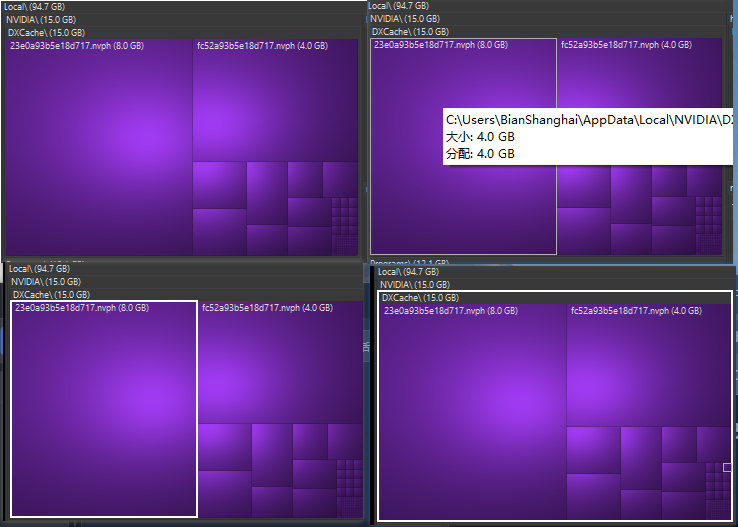

# Treemap 交互和视觉设计

日期：2026-10-25。工作分支：codex/treemap-wiztree。

## 设计意图
用户明确要求单击选中，仅双击目录卡片标题进入，参考正在运行的 WizTree 调整配色、样式、边界和悬停。

## 已确认的代码事实
- TreemapView 的 Treemap_NodeClicked 当前直接调用 DrillDown，导致单击导航。
- TreemapControl 未绘制选择或悬停轮廓，提示在移动到条目时立即开启。
- SquarifiedTreemapLayout 的目录边距从 8 像素递减，最低 3 像素；目录与文件依层级共享颜色。
- 当前标题文字使用黑色，文件标签居中。

## 参考观察与限制
cua-driver 可以读取已运行的 WizTree 窗口及截图，但管理员进程的鼠标操作被 Windows UIPI 拦截。用户随后提供同一目录的四状态参考图，现已据图确认常态、悬停、文件选择和文件夹选择的视觉差异。以下视觉规则来自用户截图，不代表已通过 cua-driver 实测 WizTree 交互。

| 状态 | 截图位置 | 视觉规则 |
| --- | --- | --- |
| 常态 | 左上 | 深灰目录标题、细暗分隔线、同类型文件统一紫色，中心偏亮且边缘偏暗 |
| 悬停 | 右上 | 当前文件出现约 1 像素细白框，并显示浅色信息提示 |
| 文件选择 | 左下 | 仅选中文件出现约 2 像素明显白框，目录及其他文件不受影响 |
| 文件夹选择 | 右下 | 白框包围被选目录的标题和全部子块，保留内部文件配色与布局 |

截图仅能确认提示的样式和出现结果，不能确定延迟时长或选择与悬停叠加的行为。提示延迟是本应用减少遮挡的设计取舍。

## 交互契约
- 单击可见目录或文件只选择；根路径、导航历史及布局保持不变。
- 仅当双击命中目录可见标题时进入目录；目录内容区域、没有可见标题的目录块和文件均不触发进入。
- 双击目标先选择再进入，避免第二次鼠标抬起选中新布局中的其他节点。
- 右键先选择对应条目，再打开现有菜单。
- 悬停和选中分开保存，离开地图只清除悬停。重新计算布局后清理失效引用和提示。
- 输入坐标与绘制坐标保持一致，验证不同 DPI 下命中位置。

## 视觉 tokens
- 背景：#202020，目录底色：#303030，标题文字：#F2F2F2。
- 目录间距：约 1 个逻辑像素，目录标题维持可读高度；底层相邻文件用细暗线分隔。
- 文件颜色：按扩展名映射稳定色组，常见类型覆盖程序、脚本、文档、图像、媒体、压缩包和磁盘镜像；未知类型使用确定性的稳定回退。
- 文件底色：常态采用均匀纯色，不绘制静态渐变。悬停时在整个 treemap 上叠加约 150 个逻辑像素半径的柔和光照，光斑跟随鼠标位置，移出即消失。保持细边界，不新增图形依赖。
- 悬停：约 1 像素白色轮廓；文件选中：约 2 像素向外加粗的持久白框；文件夹选中：约 2 像素向外加粗的白框包住标题和全部子块。轮廓最后绘制，以免被子节点盖住；不改变选中色块的原有配色。
- 文件标签：左上对齐，浅色文字配细暗色阴影；过小块不显示标签。
- 提示：使用延迟，跨条目更新内容，离开或布局重置后关闭。

## 验收
先为单击不导航、标题双击导航、非标题双击不导航、边距和颜色稳定性添加有意义的失败回归，再实施改动。运行 App/Core 测试并发布带可读时间的 Windows 独立包到 outputs。通过 cua-driver 在后台验证实际发布包，截图仅限目标应用。

## 用户后续决定
用户在实现过程中明确提出：使用纯色卡片与跟随光标的照明效果，参考较新 Windows 卡片交互。该指示替换先前的静态 cushion 明暗要求；文件和文件夹选择轮廓、标题双击导航保持原约定。

## 当前准备结果
已完成产品代码与测试实现，保留独立分支和工作目录。基线 App 测试 32 项通过；当前针对性交互与渲染测试 15 项通过。最终发布包为 C:/Users/BianShanghai/.codex/worktrees/treemap-wiztree/SpaceMonger-Copilot/outputs/SpaceMonger-2026-10-26_01-29-51。最终包的十项交互由显式验收接口核对，cua-driver 负责窗口截图，没有发送系统鼠标输入。全量回归与独立验收结果由 Comet 保存。

## 跨块光照与鼠标边界
光斑仅受整个 treemap 画布裁切，跨越相邻 cell。cua-driver 若回报 global_input，不再使用该像素输入路径；用 cua-driver 截图，并通过仅在显式验收模式启用的本地接口驱动真实控件逻辑，保持系统鼠标位置不变。

## 外描边与标题光照排除
选中描边完全位于 cell 原始矩形之外；画布固定预留两像素外边距，选择时不改变布局。悬停细框仍位于边缘内侧。光照仅排除文件夹的可见标题带；鼠标在文件夹标题带内时不激活光斑，文件标题与内容均响应光斑，光照仍跨 cell。
